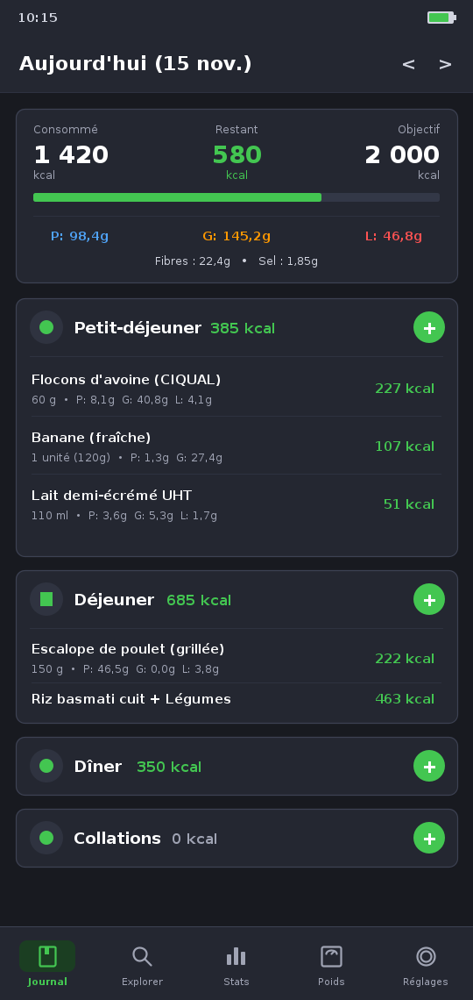
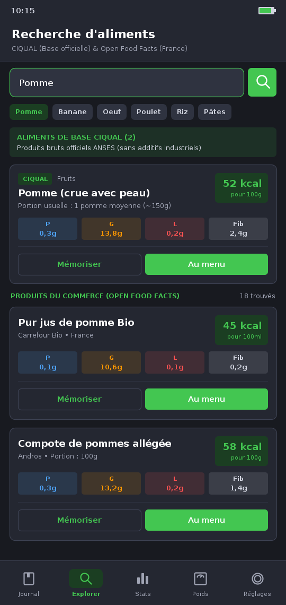
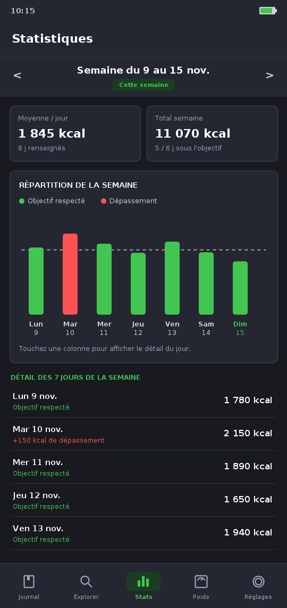
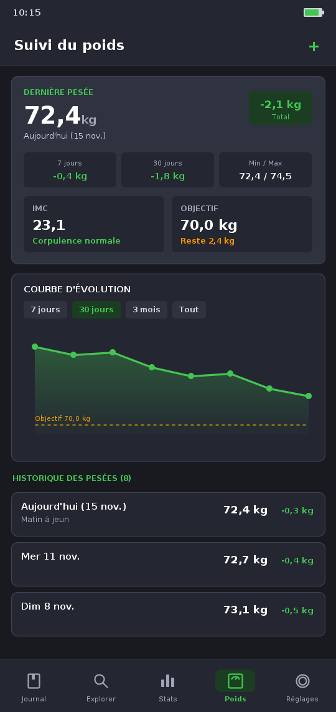
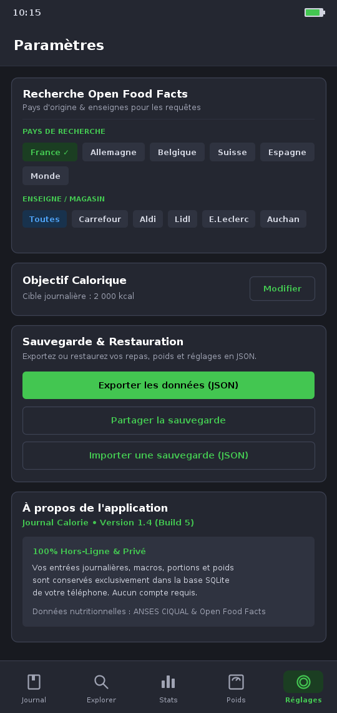

# Journal Calorie (Inspiration FatSecret)

Application Android de suivi calorique, nutritionnel et pondéral conçue pour être simple, rapide et respectueuse de la vie privée.

## 🔒 Confidentialité & Philosophie

- **100 % vie privée** : aucun tracking, aucune publicité, aucune télémétrie.
- **Aucun compte requis** : utilisable immédiatement sans inscription ni connexion obligatoire.
- **Stockage 100 % local** : toutes vos données (repas, portions mémorisées, pesées, objectifs et réglages) sont conservées exclusivement dans la base de données **SQLite (Room)** de votre appareil.

---

## 📸 Aperçu de l'application

| Journal quotidien | Recherche (CIQUAL & Open Food Facts) | Statistiques hebdomadaires |
| :---: | :---: | :---: |
|  |  |  |

| Suivi du poids & IMC | Paramètres & Sauvegarde |
| :---: | :---: |
|  |  |

---

## ✨ Fonctionnalités

### 🍽️ Journal alimentaire quotidien
- **Tableau de bord calorique** : calories consommées, restantes et objectif journalier personnalisable.
- **Suivi complet des nutriments** : protéines (`P`), glucides (`G`), lipides (`L`), fibres et sel calculés automatiquement sur la journée.
- **4 repas organisés** : *Petit-déjeuner*, *Déjeuner*, *Dîner* et *Collations* (sections repliables/dépliables avec mémorisation de l'état).
- **Navigation rapide par date** : passage au jour précédent/suivant et bouton de retour à la date du jour.

### 🥗 Bases alimentaires & Gestion des portions
- **Base locale d'aliments de base (ANSES CIQUAL)** : près d'une centaine de produits bruts non transformés classés par catégories (*Fruits, Légumes, Féculents & Pains, Viandes & Volailles, Poissons, Œufs, Laitages, Matières grasses, Douceurs & Boissons*), disponibles hors ligne avec leurs portions usuelles.
- **Recherche Open Food Facts** : interrogation des bases nationales par **pays** (*France, Allemagne, Belgique, Suisse, Espagne, Italie, Royaume-Uni, Monde*) et filtrage optionnel par **enseigne / magasin** (*Carrefour, Aldi, Lidl, E.Leclerc, Auchan, Intermarché, Monoprix, Super U, Rewe, Edeka…*).
- **Historique & Aliments personnalisés** : mémorisation automatique des aliments utilisés et de leur dernière portion, plus création manuelle de vos propres aliments.
- **Unités de mesure flexibles** : saisie en grammes (`g`), millilitres (`ml`) ou à l'unité/pièce (avec préréglages de poids unitaire et sélection automatique du texte lors de la modification).

### 📊 Statistiques hebdomadaires
- **Vue par semaine** : navigation semaine par semaine avec retour rapide à la semaine en cours.
- **Indicateurs dédiés** : moyenne journalière calculée uniquement sur les jours renseignés de la semaine affichée, total hebdomadaire et nombre de jours sous l'objectif.
- **Graphique interactif** : barres colorées selon le respect ou le dépassement de l'objectif, ligne de cible en pointillés et détail du jour au toucher (avec lien direct vers le journal correspondant).

### ⚖️ Suivi du poids & IMC
- **Enregistrement des pesées** : sélecteur de date natif (*DatePicker*), poids en kg et note optionnelle.
- **Analyse d'évolution** : variations sur **7 jours**, **30 jours**, **totale**, ainsi que poids minimum/maximum.
- **IMC & Objectif** : calcul automatique de l'Indice de Masse Corporelle (à partir de votre taille) et du poids restant jusqu'à votre cible.
- **Courbe d'évolution** : graphique filtrable sur **7 jours**, **30 jours**, **3 mois** ou **Tout**, avec ligne d'objectif.

### 💾 Sauvegarde & Interface
- **Export / Import JSON** : exportation, partage et restauration complète de la base de données et des paramètres (avec option de *fusion* ou de *remplacement*).
- **Interface moderne** : thème sombre haute lisibilité avec accent vert (Material Design 3), interface en français avec support multi-pays pour Open Food Facts.

---

## 🛠️ Technologies utilisées

- **Langage** : Kotlin
- **Interface** : Jetpack Compose & Material Design 3
- **Base de données locale** : Room (SQLite)
- **Réseau & API** : Retrofit, OkHttp & Moshi (API Open Food Facts)
- **Asynchronisme** : Kotlin Coroutines & StateFlow
